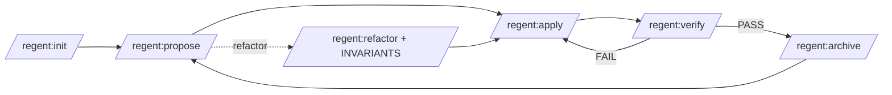

# Regent — SDD framework for Claude Code

[](LICENSE)
[](https://github.com/DanielDrzazga/regent/releases)
[](https://docs.anthropic.com/claude-code)

> A Claude Code plugin: a set of skills, agents and templates that turn Claude Code into a **structured
> engineering partner**. Work on projects follows **SDD (Spec-Driven Development)**
> + **TDD**: specification first, then tests, then code, and finally verification and archiving.

The framework enforces a repeatable, controlled change process: every feature goes
through the same cycle, every step has a dedicated agent with a matched model, and the project
documentation (`ai/docs/`) is the single source of truth for the AI.

---

## Table of contents

- [Who it's for](#who-its-for)
- [Philosophy](#philosophy)
- [Requirements](#requirements)
- [Usage](#usage)
- [Repo structure](#repo-structure)
- [Quick start](#quick-start)
- [Which command when](#which-command-when)
- [Workflow](#workflow)
- [Commands](#commands)
- [Agents and models](#agents-and-models)
- [Templates](#templates)
- [Observability (optional)](#observability-optional)
- [Conventions](#conventions)
- [Data security](#data-security)
- [Extended documentation](#extended-documentation)

---

## Who it's for

For teams and individuals who want to work with AI on real code **predictably**:
without "vibe coding", with the specification as a contract, with tests before code and with verification
before merge. The framework is **stack-agnostic** and supports **full-stack** projects
(backend + frontend) — the project's concrete realities (backend framework, UI framework, patterns)
are described by `/regent:init` in `ai/docs/`, and the commands/agents use them.

## Philosophy

1. **Spec before code** — `/regent:propose` creates a delta specification (ADDED/MODIFIED/REMOVED/INVARIANTS)
   with acceptance criteria in Given-When-Then. Bad spec = bad contract, so the spec gets challenged.
2. **TDD** — `/regent:apply` implements in the 🔴 Red → 🟢 Green → 🔵 Refactor cycle. Refactor is mandatory.
3. **The agent as a co-responsible partner** — challenges bad decisions, warns about risks,
   does not extend the scope (see `context/role.md`).
4. **Verification before closing** — `/regent:verify` is a 9-stage check (tests, spec compliance,
   code review, test verification, DB, security, repo release readiness) + conditionally observability;
   the result is persisted in `verification.md` (the gate for `/regent:archive`).
5. **Token economy** — agents read documentation **directly** (Read), they do not scan `src/`;
   tests in the TDD loop run **narrowly** (module/pattern), the full `make check` only at gates.
6. **The script counts, not the model** — delta format, AC coverage by tasks, REQ number collisions,
   AC loss on merge and code drift are checked deterministically by `scripts/sdd-check.sh`
   ([docs/sdd-check.md](docs/sdd-check.md)); the model judges what the script cannot count.

## Requirements

- [Claude Code](https://docs.anthropic.com/claude-code) with plugin support (skills, subagents, hooks).
- Optionally `make` in target projects (generated by `/regent:init`).

## Usage

This repo is a plugin marketplace (`.claude-plugin/marketplace.json`). Install it in one of two ways —
both register a marketplace named `regent`, so use one at a time.

**From GitHub (recommended).** Once per machine, no clone needed:

```bash
claude plugin marketplace add https://github.com/DanielDrzazga/regent.git
claude plugin install regent@regent --scope user
```

Update after a release (see [Versions](#versions)):

```bash
claude plugin marketplace update regent && claude plugin update regent@regent
```

**From a local clone (plugin development).** The installation is a copy of the clone's commit:

```bash
make install-local                 # once per machine, in the clone
git pull && make plugin-update     # after changes land on main
```

Start a new session after installing or updating. In a clone the same steps exist as `make install`
(GitHub) and `make install-local`; `make plugin-reinstall` / `make plugin-reinstall-local` switch between
the two sources. All targets: `make help`.

"source doesn't match its extraKnownMarketplaces entry" when adding means `regent` is still registered
from the other source: run `claude plugin marketplace remove regent` (or `make plugin-reinstall`) first.

Working on the plugin itself: `claude --plugin-dir <regent clone>` loads it straight from the clone
for one session.

### Team setup (per project)

A project declares Regent in its committed `.claude/settings.json`
([`templates/project-settings.json.template`](templates/project-settings.json.template)) — `/regent:init`
writes it (Step 3.6). Every teammate who trusts the repo folder is then offered the `regent` marketplace
and plugin, so the harness comes with the repo and needs no per-machine instructions. A project
initialized earlier: merge the template into its `.claude/settings.json` by hand.

The project entry uses the plain GitHub source, the same as `make install`. A user entry from any other
source (a local clone, a `#ref`) takes precedence: the project entry is silently ignored, and adding reports
the source mismatch described above — re-register with `make plugin-reinstall`; use `claude --plugin-dir`
for plugin work.

### Versions

`version` in `.claude-plugin/plugin.json` (SemVer) is the plugin version Claude Code compares on update;
`main` is the release branch: every PR bumps the version and every merge is tagged `v<version>`
(the lint fails on an already released version). Installs follow `main`; a teammate receives a change
on `claude plugin update`, because the version changed.
Changes per release: [`CHANGELOG.md`](CHANGELOG.md); procedure: [CONTRIBUTING.md → Releases](CONTRIBUTING.md#releases).

**Updates are not automatic.** Background auto-update is off by default for a marketplace like this one,
so without it everyone stays on the version they installed — a release on `main` does not reach them
by itself. Either:

- **turn auto-update on once:** in a Claude Code session `/plugin` → **Marketplaces** → `regent` →
  **Enable auto-update**, or
- **update by hand after a release:** `make plugin-update` in a clone, or
  `claude plugin marketplace update regent && claude plugin update regent@regent`, then a new session.

An admin can turn it on for everyone with `"autoUpdate": true` on the `regent` entry in managed settings.
Check where you stand with `make plugin-status`: it shows the installed plugin and the latest release
tag on GitHub.

Skills and agents get the `regent:` prefix (`/regent:propose`, `regent:architect`). Skills call
scripts via `${CLAUDE_PLUGIN_ROOT}/scripts/…` — Claude Code substitutes the plugin directory in the content
of skills and agents.

After installation type `/regent:` and Tab — the list shows the whole framework. Skills other than `/regent:status`
are run by you: Claude will not invoke them and will give you the command to type instead (their descriptions
also take no session context).

The plugin registers hooks (`hooks/hooks.json`): the `context/` context in the session and subagents, git-guard
in projects with `ai/docs/`, and a copy of the statusline to a fixed path
([`docs/statusline.md`](docs/statusline.md)).

### Migrating from the `~/.claude` setup

Earlier versions of this repo were installed into `~/.claude` (`CLAUDE.md`, `commands/*-sdd.md`,
`agents/`, `templates/`, `scripts/`). The plugin replaces that layout.

1. **Do not `git pull` in `~/.claude`** if you cloned this repo there directly. The pull deletes
   your global `CLAUDE.md` and `commands/` and drops the whitelist `.gitignore`, so private data
   (`history.jsonl`, `projects/`, `settings.json`) shows up as untracked files. Detach the clone first:
   `mv ~/.claude/.git ~/claude-sdd-framework.git.bak`.
2. Back up and remove the old framework files from `~/.claude`: `commands/*-sdd.md`, the SDD agents in
   `agents/`, `templates/`, `scripts/` and the SDD part of `CLAUDE.md`. Otherwise the old commands and
   agents keep loading next to the plugin.
3. Install the plugin as described above (from GitHub, or from a clone outside `~/.claude`).
4. Commands map one to one: the old `/<name>-sdd` is now `/regent:<name>` (e.g. `/regent:propose`).

## Repo structure

```
regent/
├── .claude-plugin/        # plugin.json (manifest), marketplace.json (GitHub or local marketplace)
├── context/               # role.md (partner role), sdd.md (SDD rules), sdd-map.md (map of skills and agents), subagent.md (subagent contract)
├── agents/                # 9 subagents (each with a model: field)
│   ├── architect.md              (opus)
│   ├── spec-writer.md            (sonnet)
│   ├── backend-dev.md            (sonnet)
│   ├── frontend-dev.md           (sonnet)
│   ├── code-reviewer.md          (opus)
│   ├── qa-engineer.md            (sonnet)
│   ├── dba.md                    (sonnet)
│   ├── security-auditor.md       (opus)
│   └── logging-engineer.md       (sonnet)
├── skills/                # 18 skills (/regent:propose, /regent:apply, ..., /regent:archive)
├── templates/             # Change artifact templates + Makefile
│   └── docs/              # ai/docs/ file templates (filled in by /regent:init)
├── scripts/               # sdd-check.sh (artifact validation), framework-lint.sh, statusline.sh, session-tokens.sh, eval-score.sh
├── evals/                 # skill eval sets (claude plugin eval, notes-app test project) — not used by the plugin at runtime
├── docs/                  # Framework documentation
├── .claude/               # rules for working on this repo (not part of the plugin)
└── README.md · CONTRIBUTING.md · CHANGELOG.md · LICENSE · NOTICE · CITATION.cff · Makefile (plugin installation, releases)
```

`context/` is injected by the plugin's hooks (the plugin does not load `CLAUDE.md`): `role.md` always, and in projects
with `ai/docs/` `sdd.md` and `subagent.md` in the session and in subagents, `sdd-map.md` only in the session (a subagent
does not need the skill map — that is about 4 KB less in every subagent's context). Each file
goes through a separate hook, because Claude Code truncates a single hook's output to 10,000 characters; the lint
enforces a 9000-byte limit per file.

## Quick start

```text
1. /regent:init                     # detect the stack and generate ai/docs/ (+ Makefile)
2. /regent:propose user-registration  # spec: proposal, specs (delta), design, tasks
3. /regent:apply user-registration    # TDD: Red → Green → Refactor, atomic commits
4. /regent:verify user-registration   # 9-stage verification
5. /regent:archive user-registration  # merge delta → ai/specs/, retrospective, archive
```

Supporting: `/regent:status` (project state), `/regent:explore` (read-only analysis), `/regent:logging`
(log instrumentation), `/regent:commit` (atomic commits), `/regent:testing`, `/regent:code-review`.

## Which command when

| Situation | Command |
|----------|---------|
| First time in a project | `/regent:init` |
| I don't know whether and how to do it — I want to explore options | `/regent:explore` |
| A new product or a large initiative — what we build and in which changes | `/regent:explore --discovery` |
| A new feature or a behavior change | `/regent:propose` → `/regent:apply` → `/regent:verify` → `/regent:archive` |
| Changing code structure without changing behavior | `/regent:refactor` |
| Something doesn't work and I don't know why | `/regent:debugging` |
| A bug in dev/staging | `/regent:bugfix` |
| A critical bug in production | `/regent:hotfix` |
| Back after a break — where am I? | `/regent:status` |
| Tests for existing code | `/regent:testing` |
| Review of changes (e.g. a colleague's MR) | `/regent:code-review` |
| Logs in existing code | `/regent:logging` |
| Dependency update / security patch | `/regent:dependency-update` |
| The project's approach, stack or convention changes | `/regent:revise` |
| Business knowledge: why the system exists | `/regent:wiki` |

## Workflow



Shortcuts outside the full cycle:

- **`/regent:bugfix`** — a bug in dev/staging (reproduction → failing test → minimal fix → regression);
  closed with `/regent:archive`.
- **`/regent:hotfix`** — a critical bug in production (max 30 min, max 3 files, rollback plan),
  follow-up via `/regent:bugfix`.
- **`/regent:refactor`** — a change without a behavior change, always with an INVARIANTS section in the delta spec,
  through the full cycle (not a shortcut).

## Commands

| Command | Role |
|---------|------|
| `/regent:init` | Initialization of `ai/docs/` (stack, patterns, conventions) + Makefile |
| `/regent:propose` | Spec before code (proposal, specs, design, tasks) |
| `/regent:apply` | TDD implementation (Red → Green → Refactor) |
| `/regent:verify` | 9-stage verification (stages 5-8 conditional) |
| `/regent:archive` | Merge delta specs → main, move to archive (`--abandon` — abandon the change) |
| `/regent:bugfix` | Bug fix in dev/staging (with a regression test) |
| `/regent:hotfix` | Critical fix in production (max 30 min, 3 files) |
| `/regent:refactor` | Refactoring without behavior change (INVARIANTS) |
| `/regent:revise` | Update of `ai/docs/` when the approach changes |
| `/regent:logging` | Code instrumentation with logs per `logging-patterns.md` |
| `/regent:testing` | Writing and verifying tests |
| `/regent:code-review` | Peer review of changes |
| `/regent:commit` | Atomic commits per git-workflow (one line, max 100 characters) |
| `/regent:debugging` | Systematic diagnosis (fix via `/regent:bugfix`) |
| `/regent:dependency-update` | Dependency updates and security patches |
| `/regent:status` | Overview of the project state |
| `/regent:explore` | Read-only analysis without commits |
| `/regent:wiki` | Business wiki in Obsidian (`ai/wiki/`) — outside the SDD cycle |

Definition of each skill: `skills/<name>/SKILL.md`.

## Agents and models

The model matched to the weight of the task (cost vs. required reasoning):

| Agent | Model | Use |
|-------|-------|--------------|
| `regent:architect` | **opus** | Architecture, ADR, design review |
| `regent:security-auditor` | **opus** | OWASP, security review |
| `regent:code-reviewer` | **opus** | Review + AC↔code↔test compliance |
| `regent:spec-writer` | **sonnet** | Delta specs, proposals |
| `regent:backend-dev` | **sonnet** | TDD implementation — backend (`[BE]` tasks) |
| `regent:frontend-dev` | **sonnet** | TDD implementation — UI (`[FE]` tasks, per `frontend-patterns.md`) |
| `regent:qa-engineer` | **sonnet** | Test strategy and writing tests |
| `regent:dba` | **sonnet** | Schemas, migrations, optimization |
| `regent:logging-engineer` | **sonnet** | Log instrumentation per pattern |

Definition of each agent (role, model, tools, report format): `agents/<name>.md`.
The analytical agents (`regent:code-reviewer`, `regent:security-auditor`) are **read-only** (no
Edit/Write). `regent:architect` and `regent:spec-writer` write their artifacts themselves — only the
paths the prompt names, under `ai/` — and report the paths; the approval gate runs on the written files. Verifying agents use one verdict vocabulary: `PASS / WARN / BLOCK`.

## Templates

- **Change artifacts** (`templates/`): `proposal-template.md`, `spec-template.md` (delta),
  `main-spec-template.md` (main spec — the merge target in `/regent:archive`), `design-template.md`,
  `adr-template.md`, `user-story-template.md`,
  `test-plan-template.md`, `Makefile.node.template` (other stacks: `/regent:init` generates the Makefile
  ad hoc with the same set of targets), `project-settings.json.template` (Regent declared in the
  project's `.claude/settings.json`).
- **`ai/docs/` files** (`templates/docs/`): `technology`, `architecture`, `naming`, `code-style`,
  `git-workflow`, `di-patterns`, `testing-patterns`, `exception-patterns`, `logging-patterns`,
  `frontend-patterns` (when the project has a frontend), `glossary` (domain glossary — when the project has
  its own vocabulary) — filled in by `/regent:init` with specifics detected in the project.

## Observability (optional)

If the project maintains dashboards/alerts (e.g. Kibana) in `ai/docs/observability/`, the framework
makes sure that **a change of a logged `action` does not drift apart from the dashboard**:

- `/regent:logging` (Step 4.5) and `regent:logging-engineer` flag a change of `action`/`type`/`module`.
- `/regent:verify` (Stage 7) runs the conditional checklist from `observability/maintenance.md`.

The framework **does not build** dashboards — it only forces reflection. No `observability/` → steps N/A.

## Conventions

- **Commits:** `<type>: (<KEY>) <description>` — **one line, max 100 characters, no body**. A long description =
  the commit is too big → split it into atomic ones. Never `git add .`, never a commit without tests, never `--no-verify`.
- **Logs:** `action` in the `NOUN_VERB` format (UPPERCASE, EN); only entity IDs in `context`
  (zero PII/secrets); we do not log in `domain/`.
- **Specifications:** delta (not the full state); every AC testable; INVARIANTS mandatory for refactors.
- **`ai/` in the repo:** the whole `ai/` (docs, specs, changes, archive, wiki) is tracked in the product
  repo and goes into the MR together with code and tests. REQ/AC numbers are local and do not go
  into the code.

## Data security

The repo holds only the plugin and its documentation — no data from `~/.claude` (history,
transcripts, sessions).

- Before pushing check `git status` — `git add` only with a list of specific files.
- Never commit secrets or real logs/payloads.

## Extended documentation

- [`docs/getting-started.md`](docs/getting-started.md) — first run step by step
- [`docs/workflow.md`](docs/workflow.md) — the full SDD cycle + shortcuts
- [`docs/writing-docs.md`](docs/writing-docs.md) — `ai/docs/`, logging, observability
- [`CONTRIBUTING.md`](CONTRIBUTING.md) — how to add a skill/agent/template
- [`docs/`](docs/README.md) — index of all documentation (incl. `statusline.md` — statusline configuration)

## Author

Regent is created and maintained by **Daniel Drzazga** — [github.com/DanielDrzazga](https://github.com/DanielDrzazga).
Questions, ideas and bug reports: [GitHub Issues](https://github.com/DanielDrzazga/regent/issues).
If Regent helps your team, a star on the repo is appreciated.

## License

[Apache License 2.0](LICENSE) — free for personal and commercial use. Keep the [`NOTICE`](NOTICE) file
(author attribution) in redistributions and derivative works. To cite Regent: [`CITATION.cff`](CITATION.cff).
