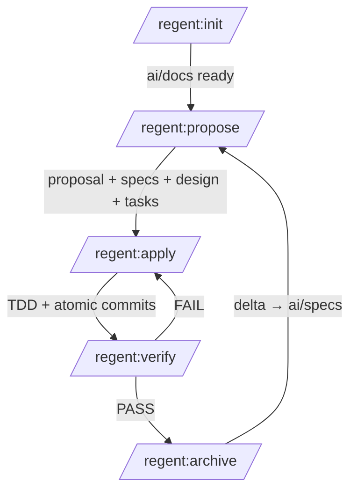

# SDD Workflow

The framework is built on one repeatable cycle for every functional change and on
a few controlled shortcuts for special cases.

## Full cycle

### 1. `/regent:propose` — spec before code

Creates `ai/changes/{name}/`:

- `proposal.md` — problem, solution, expected outcome, scope, impact and the
  `Decisions and assumptions` log (Challenge resolutions, agent assumptions, later AMENDs).
- `specs/{domain}.md` — **delta**: `ADDED` / `MODIFIED` / `REMOVED` / `INVARIANTS`; the only place
  for AC (Given-When-Then, ID `REQ-NNN/AC-n` — in tasks, reports and verification.md; it does not go into the code).
- `design.md` — approach, layers, API, DB, observability, risks.
- `tasks.md` — task list (S/M/L).

Flow: interview (one round) → Challenge (rounds of questions about decisions; the agent establishes facts itself) →
`regent:spec-writer` (proposal + delta) → `regent:architect` (design) → `regent:spec-writer` (tasks after the design) →
consistency check (Step 2.5 + `sdd-check change/preflight`) → `Draft` for review →
`approve` → `Approved`.

### 2. `/regent:apply` — TDD

Per task: 🔴 **Red** (failing test) → 🟢 **Green** (minimal code) → 🔵 **Refactor**
(mandatory). Mocks-first (shared helpers per `testing-patterns.md`). Implemented by the agent
per the task tag in tasks.md: `[BE]`/untagged → `regent:backend-dev`, `[FE]` → `regent:frontend-dev`
(per `frontend-patterns.md`), `[DB]` → `regent:dba`. The agent **runs the tests narrowly itself** in the TDD
loop; the main session makes an atomic commit per task after a report with a confirmed GREEN. The RED test
checks the task's `verification`; the session records the AC → test link and the commit hash next to the task
in `tasks.md` (tracked in the repo).

**Change of course (Step 4.5):** when the code reveals that the plan does not hold, a change of AC or design
goes through `AMEND` — the user's decision, an entry in `Decisions and assumptions`, a corrected delta.
A dev does not silently narrow AC: it reports `SCOPE:` in `OPEN QUESTIONS`. A change of goal → a new change.

### 3. `/regent:verify` — 9 stages (5-8 conditional)

| # | Stage | Agent |
|---|------|-------|
| 1 | Tests (lint, type-check, test, coverage) | main session runs `make …` |
| 2 | Spec Compliance (AC ↔ code ↔ test) | `regent:code-reviewer` |
| 3 | Code Review | `regent:code-reviewer` |
| 4 | Test Verification | `regent:qa-engineer` |
| 5 | Database Review (if applicable) | `regent:dba` |
| 6 | Security Review (if applicable) | `regent:security-auditor` |
| 7 | Observability Sync (if `ai/docs/observability/`) | main session (reflection, no delegation) |
| 8 | Smoke Check — happy path in the running app (if applicable) | main session |
| 9 | Git & Release Readiness | — |

Rule: **AC without a test = at most ⚠️ PARTIAL, never ✅ PASS.**

Before Stages 2-4 the main session counts facts with the script (`sdd-check change` and `diff`: removed
or disabled tests, fewer assertions, files outside Affected Files) and passes them to the reviewers.
`regent:code-reviewer` compares the code with `design.md` in both directions — gaps `missing` / `incomplete` /
`contradicts` / `unrequested`.

The result is written to `ai/changes/{name}/verification.md` (verdict + stage table + commit
HEAD) — this is the gate for `/regent:archive`. FAIL → fix → re-run of Stage 1 + the failed stages.

### 4. `/regent:archive`

Merge delta → `ai/specs/{domain}.md` (update of the History table; a new main spec per
`main-spec-template.md`), move to `ai/changes/archive/{YYYY-MM-DD}-{name}/`.
Requires `verification.md` with `Verdict: PASS` (`--force` = an explicit decision, an UNVERIFIED entry).
MODIFIED replaces **the whole** REQ **block** in the main spec, so the merge is surrounded by two script checks:
`sdd-check preflight` before (number collisions, MODIFIED without REQ, AC loss) and `postmerge`
after (main spec without delta format, AC consistent with the delta). `drift` warns when the change's files
moved after verification.

**Abandoning a change:** `--abandon` closes an abandoned change (unfinished tasks are then
the reason for closing, not a blocker). The delta is **not** merged — main specs describe code that
exists — and the History entry gets `ABANDONED` with the reason. This is the alternative to `rm -rf`, which
loses the delta spec and the trace that the topic was raised.

**Retrospective (Step 3.5)** — one question based on the change's artifacts: `NO FINDINGS`
or a finding with a concrete action (most often `/regent:revise`). The finding goes into the History
table, not into a separate file.

## Shortcuts

| Shortcut | When | Limits |
|-------|-------|--------------|
| `/regent:bugfix` | A bug in dev/staging | Reproduction → failing test → minimal fix → regression test; closed with `/regent:archive` |
| `/regent:hotfix` | A critical bug in production | Max 30 min, max 3 files; rollback plan; follow-up via `/regent:bugfix` |
| `/regent:refactor` | A change without a behavior change | **INVARIANTS mandatory** (in the delta spec), full propose→archive cycle — not a shortcut |

## Documentation maintenance

- `/regent:status --drift` — audit: commits touching files of archived changes outside the SDD
  cycle (a hotfix without follow-up, a manual fix), i.e. places where the main spec may have stopped
  describing the code.
- `/regent:revise <file>` — when the implementation reveals a change of approach, update `ai/docs/`
  (do not change them "silently" — other agents read from them).
- `/regent:logging` — after adding/changing a logged `action` with an existing `ai/docs/observability/`
  check `observability/maintenance.md` (Stage 7 in `/regent:verify`).
- `/regent:wiki` — **outside the SDD cycle**. Maintains `ai/wiki/` (an Obsidian vault): business knowledge
  about *why* the system exists. The code gives the skeleton (entities, states, actors), meaning comes from
  external sources via `ingest` (meeting notes, emails, transcripts). It reads
  `ai/docs/domain/glossary.md` and `ai/specs/`, it does not modify them.

## Cross-cutting rules

- Delegation: a command with an assigned agent runs it as a **subagent** (the Task tool) —
  the model from `agents/*.md` works only then, not "in place" in the main session.
  Full command→subagent mapping: `context/sdd-map.md`.
- A subagent does not talk to the user — approval gates are run by the main session;
  the subagent returns artifacts for approval in its report (the contract in `context/subagent.md`).
- The spec is a contract — challenge a bad spec before implementing.
- Do not extend the scope beyond the specification (scope creep).
- Do not commit without tests — not even in a hotfix.
- Save tokens: Read instead of scanning `src/`; tests in the TDD loop narrowly
  (module/pattern), the full `make check` only at gates.
